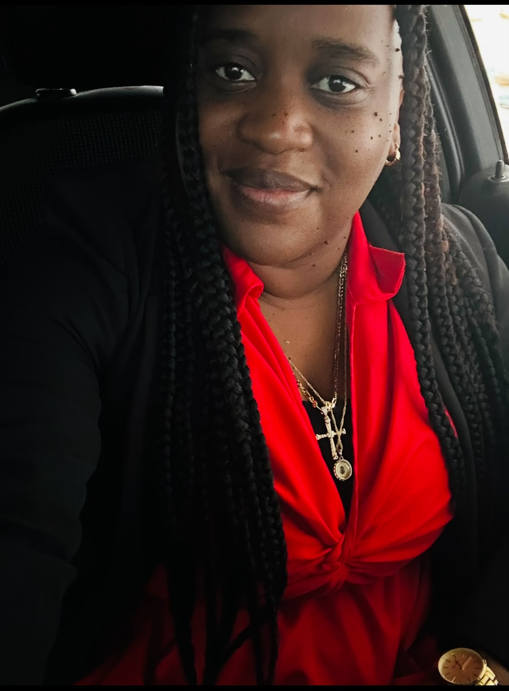

<!DOCTYPE html>
<html lang="en">
<head>
  <meta charset="UTF-8">
  <meta name="viewport" content="width=device-width, initial-scale=1.0">
  <meta name="theme-color" content="#fff9fc">
  <meta name="description" content="Minnette Johnson is a graduate student from Belize exploring software engineering, research, and thoughtful technical decisions.">
  <title>Minnette Johnson | Graduate Portfolio</title>
  
</head>
<body>
  <a class="skip-link" href="#main">Skip to content</a>

  <header class="site-header">
    <nav class="nav container" aria-label="Main navigation">
      <a class="brand" href="#home">
        Minnette Johnson
        <small>Software Engineering Portfolio</small>
      </a>
      

        <a href="#home">Home</a>
        <a href="#portfolio">Portfolio</a>
        <a href="#philosophy">My approach</a>
        <a href="#about">About</a>
        <a class="github-link" href="https://github.com/minnettejohnson-dot" target="_blank" rel="noopener noreferrer">GitHub ↗</a>
      

    </nav>
  </header>

  <main id="main">
    <section class="hero" id="home">
      

        

          
Graduate Student · Software Engineering

          <h1>Hi, I’m <em>Minnette.</em></h1>
          

            
I’m a <strong>graduate student from Belize</strong>, interested in how thoughtful software engineering can solve real problems and how the decisions behind a system shape the people who use it.

            
I’m currently pursuing a <strong>Master of Science in Software Engineering (MSSE) at <a href="https://www.regis.edu/academics/majors-and-programs/graduate/software-engineering-ms" target="_blank" rel="noopener noreferrer">Regis University</a></strong>. This site brings together selected coursework, the technical decisions I make, and the lessons I take with me as I grow. I’m interested not only in how software works, but in why one approach makes more sense than another—and who benefits from the choices we make.

          

          

            <a class="primary-link" href="#portfolio">Explore my work</a>
            <a class="text-link" href="#philosophy">A little about how I think →</a>
          

        

        

          

            
            

              

                
MJ

                
Your photo goes here. Upload a portrait named <strong>minnette.jpg</strong>.

              

            

          

          
A little corner of my journey, from Belize and beyond.

        

      

    </section>

    

      

        Learning with intention
        Thoughtful technical decisions
        Room to keep growing
      

    

    <section class="content-section records-section" id="portfolio">
      

        

          
Selected graduate work

          <h2>Decisions worth documenting.</h2>
          
My portfolio decision records capture more than a final answer. They make space for the problem, the alternatives I considered, the reasons behind a choice, and what I learned along the way.

        

        <article class="record">
          
01

          

            
MSSE-601 · Software Engineering Foundations

            <h3>Hybrid Modular Architecture</h3>
            
This decision record explores a hybrid modular monolith with an independently deployed Telemetry Service. It looks at the options, why this approach was selected, and the trade-offs that come with the decision.

          

          <a class="record-link" href="msse601/MSSE601-ADR-hybrid-architecture.md">Read the record ↗</a>
        </article>

        
This collection will grow as I move through the programme. I’ll add new records when there is a decision or lesson worth revisiting.

      

    </section>

    <section class="content-section philosophy-section" id="philosophy">
      

        

          
My approach

          <h2>The answer matters. The thinking matters, too.</h2>
        

        

          <blockquote class="philosophy-quote">I want to remember not only what I chose, but why it made sense at the time.</blockquote>
          

          
Software engineering asks us to make choices, often without a perfect option. I’m learning to slow down enough to ask better questions, compare alternatives fairly, and think about what a decision means beyond the code itself.

          
For me, documenting the process is part of the learning. It gives me something honest to look back on: what I understood, what I missed, and how my thinking changes as I gain experience. I don’t expect to have every answer. I do want to stay curious, be willing to reconsider, and keep getting better at the work.

        

      

    </section>

    <section class="content-section about-section" id="about">
      

        

          
A little more about me

          <h2>Rooted in Belize. Still curious about what’s next.</h2>
          
Belize is home, and this portfolio is one small part of a much bigger learning journey. Through my graduate studies, I’m building a record of the questions I ask, the decisions I take responsibility for, and the skills I’m developing along the way.

          
I hope this site will become a useful record of my growth—not a showcase of perfect work, but a place where the learning is visible, too.

        

        <aside class="future-note">
          
Looking a little further ahead

          
Looking further ahead, I hope to pursue a PhD in Computer Science, with room to explore how computing, AI, and learning can support people. It is a goal I’m working toward one step at a time. For now, I’m focused on building a strong foundation, staying curious, and learning as much as I can along the way.

        </aside>
      

    </section>
  </main>

  <footer>
    

      
© 2026 Minnette Johnson · Made as part of my learning journey.

      

        <a href="#home">Back to top ↑</a>
        <a href="https://github.com/minnettejohnson-dot" target="_blank" rel="noopener noreferrer">GitHub ↗</a>
      

    

  </footer>
  
</body>
</html>
